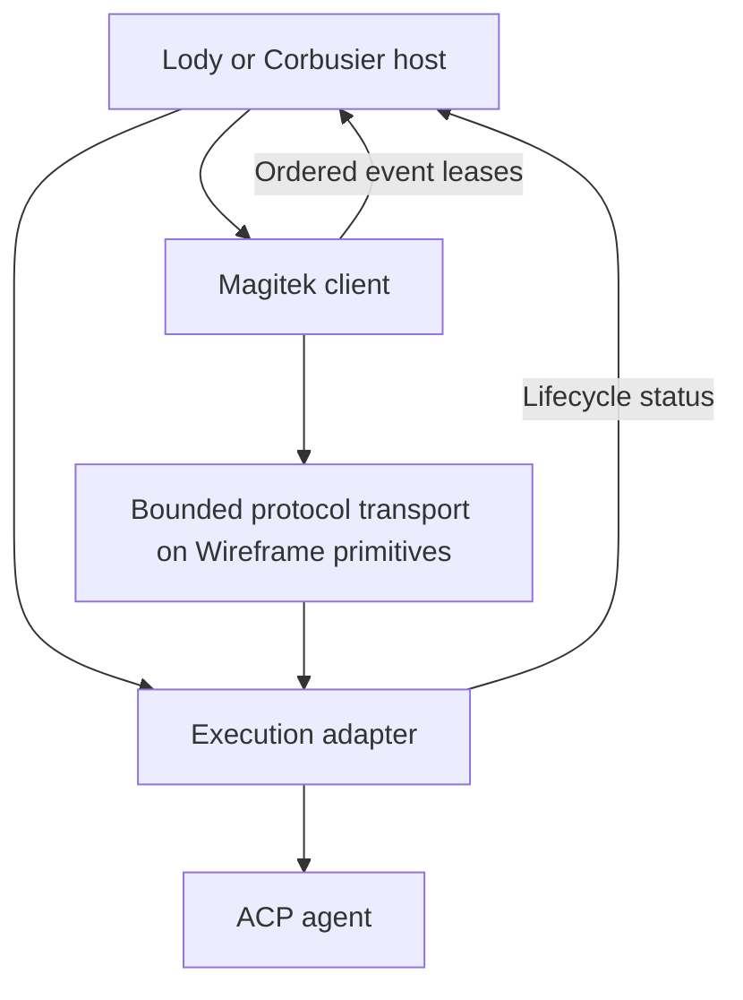
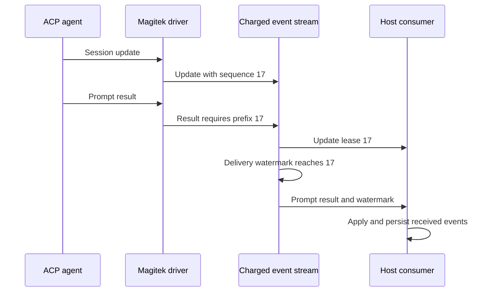
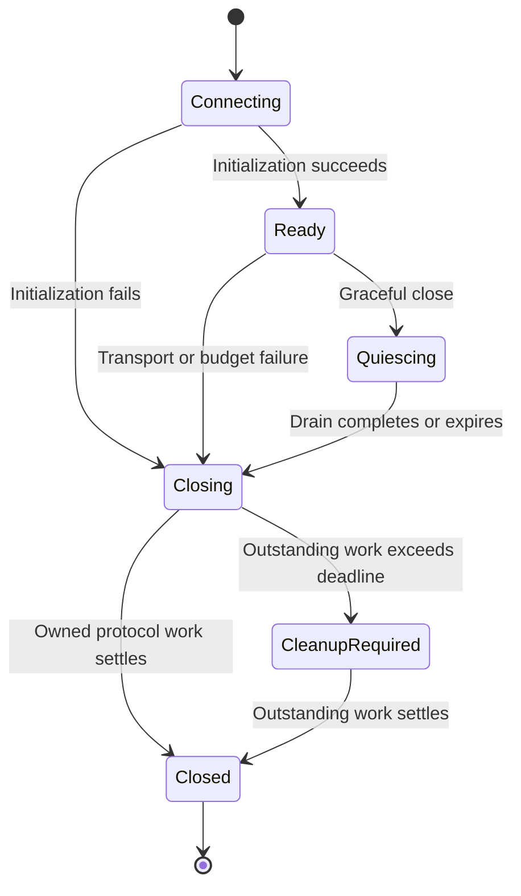

# Magitek – technical design

- **Status:** Draft v0.2; proposed architecture, no implementation claim.
- **Date:** 2026-11-19.
- **Audience:** Rust library implementers, host integrators, and reviewers.
- **Scope:** A bounded asynchronous Agent Client Protocol (ACP) client and
  reusable protocol framing and resource-accounting primitives.
- **Companions:** [Terms of reference](terms-of-reference.md),
  [context and terminology](context.md), and [GIST roadmap](roadmap.md).

The terms of reference define the problem and goals. `context.md` defines
domain vocabulary. This design defines proposed behaviour. The
[resource-policy schema](contracts/resource-policy.schema.json) defines the
policy data shape; section 5 defines its additional semantic constraints.
Examples illustrate that contract and do not establish production defaults. An
inconsistency among these documents blocks acceptance of the design.

## Contents

- [1. Decision summary](#1-decision-summary)
- [2. Requirements and boundaries](#2-requirements-and-boundaries)
- [3. Foundation](#3-evidence-and-implementation-foundation)
- [4. Execution ownership](#4-architecture-and-execution-ownership)
- [5. Resource admission and accounting](#5-resource-admission-and-accounting)
- [6. Framing and bidirectional transport](#6-framing-and-bidirectional-transport)
- [7. Event delivery](#7-dispatch-ordering-and-event-delivery)
- [8. Session lifecycle and host services](#8-session-lifecycle-and-host-services)
- [9. Cancellation, failure, and recovery](#9-cancellation-failure-and-recovery)
- [10. Interfaces](#10-public-interface-and-integration-contracts)
- [11. Observability and diagnostics](#11-observability-and-diagnostics)
- [12. Verification and qualification](#12-verification-and-qualification)
- [13. Delivery](#13-delivery-compatibility-and-open-decisions)
- [14. References](#14-references)

## 1. Decision summary

Long-lived agent hosts need predictable resource ownership and truthful failure
outcomes when an agent, application callback, or output consumer stops making
progress. Magitek centralizes that contract for the Rust Lody replacement and
hosts that use Podbot. The library limits its own work and payload retention;
the embedding application controls execution resources, permissions,
persistence, and recovery.

The proposed first implementation has these boundaries:

1. Speak stable ACP v1 through a qualified implementation foundation. Prefer
   the official Rust software development kit (SDK), including a bounded
   upstream path or maintained patch where necessary. Select the foundation
   only after the section 3 qualification gate.
2. Accept host-owned asynchronous byte streams. Use Tokio integration first,
   without creating a private runtime or a thread per connection.
3. Admit frames, requests, handlers, session updates, and waiting producers
   against finite local and shared budgets. Keep charges with retained data.
4. Deliver ordered typed session events, preserving supported payloads and
   extension data within the declared profile. Report unsupported data and
   stream incompleteness explicitly.
5. Separate cancellation intent, peer terminal evidence, transport closure,
   and external process exit. Never replay an uncertain prompt automatically.
6. Expose framing and accounting to an ACP-aware proxy without requiring that
   proxy to become an ACP client.
7. Obtain resource accounting, byte-stream framing, bounded decoding, and
   bounded encoding from Wireframe's native-protocol primitives, without its
   server router, default envelope, or an embedded ACP engine. Each capability
   waits for the Wireframe roadmap task that delivers it. Section 3.3 and
   [ADR 0001](adrs/adr-0001-reuse-wireframe-for-budgeting-and-stream-parsing.md)
   record this decision.

This draft does not select a JSON-RPC engine, promise a fixed resident memory
ceiling, or claim that library scheduling guarantees host heartbeats. JSON-RPC
means JavaScript Object Notation Remote Procedure Call. Hard process limits and
daemon liveness scheduling belong to the host.

## 2. Requirements and boundaries

### 2.1. Goal traceability

The goals below use the identifiers in the terms of reference. An acceptance
record must identify the exact implementation, profile, and host conditions.

| Goal | Design obligation                                                                                           | Principal sections |
| ---- | ----------------------------------------------------------------------------------------------------------- | ------------------ |
| G1   | Account for retained payloads, work, and admission waiters.                                                 | 5, 6, 12           |
| G2   | Keep protocol progress independent of slow business work, with explicit failure when bounded progress ends. | 4, 6, 7, 11, 12    |
| G3   | Preserve typed session events and order completion after preceding relevant updates.                        | 7, 8, 10, 12       |
| G4   | Expose delivery uncertainty and distinct cancellation evidence.                                             | 8, 9, 10, 12       |
| G5   | Reuse the client across execution hosts while preserving proxy and policy boundaries.                       | 2, 4, 10, 13       |
| G6   | Make guarantees auditable through diagnostics and reproducible qualification.                               | 3, 11, 12, 13      |

_Table 1: Terms-of-reference goals mapped to technical obligations._

### 2.2. Ownership and exclusions

| Owner             | Responsibilities                                                                                      | Boundary supplied to Magitek                                          |
| ----------------- | ----------------------------------------------------------------------------------------------------- | --------------------------------------------------------------------- |
| Host application  | Work selection, authorization decisions, configuration loading, persistence, and recovery.            | Validated policy, host services, event consumer, and runtime service. |
| Execution adapter | Process or container creation, workspace, credentials, diagnostics capture, and lifecycle actions.    | Byte streams and separately observed lifecycle state.                 |
| Magitek           | ACP negotiation, correlation, admitted dispatch, ordered delivery, budgets, and protocol termination. | Typed client handles, charged events, and failure evidence.           |
| Peer agent        | Its own execution and protocol compliance.                                                            | ACP messages and independently observable process behaviour.          |

_Table 2: Responsibility boundaries for an embedded connection._

The core does not depend on Loro, SQLite, `oauth2`, `restson`, Bollard, or a
Kubernetes client. The Lody host may use those libraries in their existing
domains. Wireframe is the planned exception among infrastructure libraries: the
core uses its framing and reservation primitives, and none of its server,
routing, or connection-pool facilities (section 3.3). A host can load settings
with `ortho-config` and convert them into a validated Magitek policy; Magitek
does not search repository configuration or environment variables for authority.

Provider catalogues, workflow scheduling, durable command journals, transcript
storage, and arbitrary process reattachment remain host responsibilities.
Podbot retains its sandbox enforcement and execution role. The initial library
does not offer a command-line application or an installation workflow.

### 2.3. Trust and capability boundaries

Peer bytes are untrusted for allocation, parsing, and protocol purposes. A
faulty peer is sufficient to exercise this boundary; hostile intent is not
required. Host callbacks are trusted policy implementations, but may fail,
block, or allocate outside Magitek's accounting.

Advertise a client capability only when the host has installed an appropriate
service and its policy permits that service. Recheck authority on each request.
Possessing a schema type or receiving a file path grants no access. Filesystem
containment, symlink handling, environment policy, and terminal execution
location remain obligations of the selected host service.

Protocol authentication uses methods the peer advertises. Magitek may carry
typed authentication exchanges through a host-provided broker, but does not
discover credentials, launch a login browser, or substitute a cloud OAuth flow.
Permission approval and authentication remain separate concepts.

## 3. Evidence and implementation foundation

### 3.1. Inspected baseline

The source investigation on 14 November 2026 found these constraints. These are
source observations, not Magitek benchmark results. The context document
records the source pins and evidence categories.

| Candidate or consumer  | Observed evidence                                                                                                                                                                         | Consequence for qualification                                                                                            |
| ---------------------- | ----------------------------------------------------------------------------------------------------------------------------------------------------------------------------------------- | ------------------------------------------------------------------------------------------------------------------------ |
| Official ACP SDK 5.3.0 | Its connection and session paths use unbounded channels, and its byte adapter reads complete lines without a configured line limit.[^1]                                                   | Audit all producers, internal handoffs, task admission, and subscriptions. A bounded wrapper alone is insufficient.      |
| Agentkit SDK 3.6.0     | Provides frame charges and explicit admission limits. Its ordinary transport and high-level session paths retain legacy or unbounded interfaces.[^2]                                      | Qualify the complete selected path and reconcile its earlier SDK/schema family with the required protocol surface.       |
| Mango ACP harness      | The inspected main branch uses official schema types with its own bounded JSON-RPC peer and host process ports. Its harness deliberately normalizes and filters some session data.[^3]    | Evaluate the lower-level peer separately from the normalized harness; preserve full-fidelity delivery requirements.      |
| Podbot                 | A bounded stdin command queue exists, while diagnostics and protocol output share a drain loop. Oversized unterminated ACP output triggers raw forwarding in the inspected assembler.[^4] | Carry shared stall, fragmentation, and enforcement invariants into proxy adoption.                                       |
| Wireframe 0.3.0        | RFCs 0003–0008 propose bounded delimiter framing, typed reservations, and a full-duplex driver for a standalone ACP consumer. Every phase 21 roadmap task is unchecked.[^11]              | Treat the contracts as proposals. Gate each Magitek task on the delivering Wireframe task and qualify a pinned revision. |

_Table 3: Source evidence that constrains the implementation choice._

An internal unbounded channel can sit inside a bounded system if every producer
requires admission and charges survive every handoff. The audit must prove
those conditions or identify the escape. Searching for channel type names alone
does not establish the guarantee.

Agentkit's inspected fork uses its own schema 1.14.0, whereas the inspected
upstream SDK uses schema 1.18.0. This identifies a Rust dependency and feature
qualification gap; it does not prove stable ACP v1 wire incompatibility.
Mango's inspected main branch identifies version 0.8.0; published documentation
inspected during research identified 0.7.1. Qualification must name one exact
revision rather than mix the two.[^1][^2][^3]

### 3.2. Foundation decision gate

Run the same conformance fixtures through each plausible foundation and record
a producer-to-consumer ownership map. The record must cover physical framing,
decoding, protocol dispatch, pending replies, dynamic handlers, session
subscriptions, outgoing serialization, and physical writes.

| Option                                          | Prefer when                                                                                                 | Reject or defer when                                                                           |
| ----------------------------------------------- | ----------------------------------------------------------------------------------------------------------- | ---------------------------------------------------------------------------------------------- |
| Official SDK with qualified bounded integration | All retained paths can satisfy the contract with a maintainable change set.                                 | Hidden queues or escaped handles prevent admission enforcement.                                |
| Agentkit-based integration                      | Its charged paths and compatible adapters pass the complete client tests at an acceptable maintenance cost. | Version lag or unqualified session paths require a larger divergence than the upstream option. |
| Reuse Mango's lower-level peer                  | Its peer can expose the required ACP surface without harness filtering or unwanted host ownership.          | Required fidelity, host callbacks, or dependency constraints do not fit.                       |
| Narrow dispatcher on Wireframe's duplex driver  | The preceding options fail documented must-pass criteria, and Wireframe tasks 21.8.5–21.8.6 are delivered.  | The proposal merely duplicates an existing qualified path, or adds a second dispatch loop.     |

_Table 4: Foundation choices and their decision criteria._

Every option runs above Wireframe's framing and reservation layer (section
3.3). The gate therefore selects the ACP engine: the component that owns
correlation, dispatch, and session state. The narrow dispatcher uses official
schema types and Wireframe's duplex session driver instead of a dispatcher
written from nothing.

The decision record must identify licences, dependency changes, the supported
stable-v1 surface, outstanding upstream work, maintenance ownership, and the
cost of carrying a patch. It must also pin the qualified Wireframe revision or
exact release. A schema-only dispatcher changes the original SDK-reuse premise
and therefore requires an explicit recorded decision. The roadmap permits that
decision; this draft does not silently make it.

### 3.3. Wireframe reuse and adoption gates

[ADR 0001](adrs/adr-0001-reuse-wireframe-for-budgeting-and-stream-parsing.md)
records the decision to obtain budgeting and stream parsing from Wireframe.
Wireframe's proposed contracts name Magitek as a standalone consumer and
require these primitives to work without a server application, a default
envelope, or a second protocol engine.[^11] The contracts are proposals, and
the tasks below are unchecked at the inspected revision. A mapping in Table 5
describes planned reuse, not delivered behaviour.

| Magitek mechanism                                     | Design sections | Wireframe contract   | Gating Wireframe task | First dependent Magitek tasks     |
| ----------------------------------------------------- | --------------- | -------------------- | --------------------- | --------------------------------- |
| Immutable policy validation                           | 5.1–5.2         | RFC 0007             | 21.8.1                | 1.1.2                             |
| Reservations, ownership transfer, and retirement      | 5.3–5.4         | RFC 0007             | 21.8.2                | 2.1.1, 2.1.2                      |
| Bounded delimiter framing and raw JSONL frames        | 6.1             | RFC 0006             | 21.8.3                | 2.2.1                             |
| Admitted semantic decoding and bounded encoding       | 4.2, 5.1, 6.1   | RFCs 0003, 0006–0007 | 21.8.4                | 1.2.5, 2.2.2, 2.2.3               |
| Byte-preserving enforced proxy inspection             | 6.3             | RFCs 0006, 0008      | 21.8.8                | 4.1.1                             |
| Combined overload and ownership verification evidence | 12              | RFCs 0002, 0007–0008 | 21.8.9                | 4.3.2                             |
| Enforcement-point map and interface migration record  | 5.1, 13         | RFCs 0003, 0008      | 21.8.10               | 4.4.2                             |
| Supplied transport halves and role-neutral driver     | 4.2, 7.1        | RFCs 0004–0005       | 21.8.5                | 2.3.1, 2.3.3 (conditional)        |
| Publication evidence and pressure-independent closure | 6.1, 7.3, 9.1   | RFCs 0004, 0007      | 21.8.6                | 2.2.3, 3.2.1, 3.2.2 (conditional) |

_Table 5: Planned Wireframe reuse and the task that gates each mechanism._

The final two rows apply only if the foundation decision selects Wireframe's
duplex session driver. Under any other engine, Magitek implements independent
progress and publication evidence above Wireframe's reservations, and those two
Wireframe tasks do not block it. Wireframe's own prerequisites apply
transitively: tasks 21.8.1–21.8.4 also need Wireframe tasks 21.1.1–21.1.3 and
21.2.1, and task 21.8.5 needs 21.2.2.

Magitek retains everything that gives the mechanisms ACP meaning:

- The resource-policy schema, its ACP-specific cross-field rules, and the
  conversion of a validated policy into a Wireframe profile.
- The JSON adapter's profile choices, including duplicate-key rejection, batch
  handling, and line-ending acceptance.
- Correlation, capability negotiation, session and generation state, event
  sequencing, watermarks, and the delivery fence.
- Submission evidence, terminal failure categories, and the public facade.

Wireframe types stay inside the transport and admission modules. ACP session
logic depends on Magitek-owned types, so a change of Wireframe revision cannot
alter the public contract without a deliberate facade change. The enforced
paths expose no Wireframe handle that bypasses accounting.

Each adopted Wireframe revision or release needs a qualification record. It
names the exact revision or version, the enforcement point behind every policy
field, any conservative overcharge, and memory that remains outside the ledger.
The release matrix and compatibility statement name the qualified version
exactly, because a downstream consumer resolves the dependency in its own
lockfile; a consumer that resolves another version is outside the advertised
profile. Wireframe cannot meter an engine's internal queues. The ownership map
must therefore cover each handoff between Wireframe and the selected engine,
and must show that the engine accepts admitted frames without an uncharged
second read or parse. If Wireframe withdraws a gating contract, the dependent
Magitek tasks remain blocked until a superseding decision record selects
another source.

## 4. Architecture and execution ownership

### 4.1. Composition

The host creates the execution adapter and drives Magitek. Protocol traffic
flows through Magitek's transport, while execution status reaches the host
independently.

_Figure 1: Execution ownership and ACP traffic follow separate paths._

Start with one crate and internal modules for transport, admission, client
state, events, and diagnostics. The transport and admission modules adapt
Wireframe's framing and reservation primitives to the Magitek policy; the
remaining modules own ACP behaviour. Place an optional local-process adapter
behind an explicit feature. Keep a Podbot adapter in integration code until its
shared contract stabilizes. The core must not depend on Podbot, and Podbot must
not depend on a Magitek adapter that creates a dependency cycle.

### 4.2. Execution domains

| Domain               | Allowed work                                                             | Progress obligation                                                                      |
| -------------------- | ------------------------------------------------------------------------ | ---------------------------------------------------------------------------------------- |
| Frame reader         | Incremental bounded framing and admitted decoder submission.             | Poll transport and observe cancellation without waiting on application work.             |
| Decoder work         | Size-bounded parsing and schema conversion under CPU-job admission.      | Retain all charges; preserve ingress order when results return.                          |
| Protocol dispatcher  | Correlation, state transitions, capability checks, and admitted handoff. | Perform short bounded work per poll; never await later traffic from the same connection. |
| Frame writer         | One serialization/write owner, with bounded control admission.           | Retain charges until completion or failure and enforce write deadlines.                  |
| Host-service workers | Permission, filesystem, and terminal service calls.                      | Respect admission, response obligations, generation checks, and cancellation.            |
| Event consumer       | Host projection, persistence, and presentation.                          | Release or transfer leases; accept explicit pressure if it falls behind.                 |

_Table 6: Work placement and progress obligations._

The first runtime adapter uses Tokio byte traits and timing. An SDK shim may
adapt these to the SDK's I/O traits. It must not expose an uncharged raw
connection handle. The host drives one connection driver and supplies any
worker capacity; Magitek neither starts a private runtime nor spawns one task
per notification without admission.

The qualified implementation must specify the synchronous parsing envelope.
Larger or less predictable decode work uses an admitted worker boundary with
bounded queued and running jobs. Preserve source order through a bounded
reorder buffer or a serial per-connection decoder. A worker timeout does not
reclaim a still-running computation: charges remain until it actually ends, and
close can report outstanding cleanup. The `processing` deadline covers decoder
queue residence and execution from CPU-work admission.

CPU service remains a host precondition. An async timeout cannot run while its
executor has no service, and it cannot pre-empt arbitrary blocking code. Lody's
heartbeat scheduler therefore stays in the daemon's separate liveness domain.
Magitek reports its own backlog and progress to that supervisor.

## 5. Resource admission and accounting

### 5.1. Policy and units

The [policy schema](contracts/resource-policy.schema.json) and
[illustrative profile](contracts/resource-policy.example.json) define a
reviewable configuration shape, not a public serialization API commitment. All
counts, byte limits, and millisecond deadlines are finite positive integers.
Zero, negative values, and unlimited sentinels are invalid.

| Policy group   | Meaning                                                                                                                                                                                               |
| -------------- | ----------------------------------------------------------------------------------------------------------------------------------------------------------------------------------------------------- |
| `connection`   | Caps live sessions, active prompts, outgoing requests, incoming requests, handler jobs, CPU jobs, waiting calls, and routes.                                                                          |
| `frame`        | Caps encoded inbound/outbound frames, JSON nesting, JSON nodes, and identifiers.                                                                                                                      |
| `buffers`      | Caps retained owned payload bytes and decoded nodes, with item/byte ceilings for ingress, egress, and event stages.                                                                                   |
| `reserve`      | Protects control egress and terminal-event capacity inside the enclosing budgets.                                                                                                                     |
| `deadlines_ms` | Bounds admission waits, initialization, ordinary request/response exchanges, partial-frame assembly, decode processing, writes, service work, permission waits, drain, cancellation grace, and close. |
| `global`       | Caps admitted connection generations, including retained closed generations, payload bytes, handler/CPU jobs, and waiting calls across a host budget.                                                 |

_Table 7: Resource policy groups and their units._

Encoded frame sizes exclude the line delimiter. The framer separately allows at
most the selected delimiter's two bytes. An owned payload charge counts
retained wire buffer capacity and retained decoded string, byte-array, and
extension payload capacity. Decoded node counts and fixed object/task counts
bound structural populations separately. This ledger does not measure Rust
allocator metadata, stack size, arbitrary host allocations, or process RSS.

Copies require additional charges; shared immutable allocations retain one
charge until the last owning handle disappears. Temporary serialization and
decoding allocations count while live. Admission precedes allocation of the
bounded storage it authorizes. A decoder must reserve a conservative envelope
before materialization, or use a budget-aware visitor; parsing an unrestricted
object tree and checking its size afterwards does not satisfy the contract.

Every field must map to an implementation enforcement point and a metric.
Magitek converts a validated policy into a Wireframe reservation profile, so
many enforcement points sit in the pinned Wireframe revision. The qualification
records for that revision and for the selected foundation identify any
conservative overcharge and any memory outside the ledger. Runtime-sized opaque
payloads cannot bypass this mapping through an extension API.

### 5.2. Cross-field validity

JSON Schema validates shape and individual ranges. The policy constructor must
additionally reject these inconsistent configurations, using checked arithmetic
before allocating. Wireframe's policy validation supplies the generic
parent/child, reserve, and overflow checks; Magitek adds the rules that depend
on ACP operations and its control envelope:

1. An ingress byte budget smaller than `max_inbound_bytes + 2`, or an ordinary
   egress byte budget smaller than `max_outbound_bytes + 2` after control
   reserve. The two bytes accommodate the longest supported delimiter.
2. A stage byte limit larger than the connection's owned-payload limit.
3. A connection owned-payload limit larger than the shared host limit.
4. Active prompts above live-session or outgoing-request capacity; routes
   below live-session capacity; decoded-node capacity below one frame's node
   limit; or a maximum identifier larger than an inbound or outbound frame.
5. Control reserve consuming the entire egress item or byte budget, or
   terminal reserve consuming the entire event item budget.
6. Control slots below outgoing requests plus incoming requests plus active
   prompts plus one connection-control slot. This conservative profile reserves
   one bounded answer or cancellation obligation per admitted owner.
7. Control bytes below control slots multiplied by
   `max_control_frame_bytes + 2`, or a control frame larger than the outbound
   frame limit. Include delimiter storage in the reserved wire capacity.
8. Terminal event slots below active prompts plus one connection-terminal
   slot. Full-fidelity result payloads still need ordinary byte admission; lack
   of it produces explicit overload, never a fabricated result.
9. Global handler, CPU-job, or waiting-call caps below a single connection's
   corresponding cap; or shared bytes below the protected control reserve for
   the maximum connection count.
10. A complete bounded control envelope, including the largest permitted
    correlation identifier, that cannot fit its configured control-frame
    limit. Validate this with the selected schema/encoder, including escaping.

The example satisfies the numerical relationships. Its control-envelope fit,
decoder overhead, default suitability, and achievable latency require the
foundation and benchmark gates. A syntactically valid profile cannot waive
those qualification obligations.

### 5.3. Admission and ownership transfer

Use one shared host budget with per-connection subordinate budgets, expressed
through Wireframe's shared-host, connection-generation, and stage reservation
scopes. Acquire a complete reservation atomically, or roll back immediately;
never hold one budget's lock or partial permit while awaiting another.
Protected control capacity counts against the shared budget at connection
admission. Ordinary traffic cannot borrow it.

The `max_connections` permit counts a connection generation until retirement,
including any interval after `Closed`. Retirement requires release of its
leases, decoded nodes, workers, routes, pending metadata, and retained owned
state. Reconnection acquires a new permit from the same host budget. This keeps
per-generation structural limits meaningful across repeated closure;
zero-length payloads cannot evade them. Host-retained independent copies stay
outside this ledger. A status snapshot does not retire its source generation.

The default submission interface fails promptly when it cannot admit work. An
explicit waiting interface has its own bounded waiter count and deadline.
Waiting callers can retain input outside the library before admission; that
memory remains the caller's responsibility and must appear in API docs. Magitek
must not capture unlimited caller payloads in a hidden wait queue.

Reservations follow work through queue removal, decoding, SDK handoff,
application delivery, and partial writes. Queue item occupancy may decrease
when an item moves, but the connection/shared payload charge survives until the
last relevant owner releases it. Treat each representation change as a transfer
or a temporarily double-charged copy.

Round-robin service among ready connections and bounded work batches prevent
one busy connection from monopolizing admitted driver work. Admission waiting
uses a declared FIFO policy; a deadline can fail an oversized waiting demand
rather than make smaller demands wait indefinitely. Fair scheduling does not
promise delivery through a stalled physical stream.

### 5.4. Event leases and reclamation

The proposed event API returns a non-cloneable owning `EventLease`. Its view
borrows the typed payload. The lease keeps its charge through a Wireframe
ownership guard, held directly or behind a Magitek-owned ledger port. Each
queued or issued lease retains one item permit from `buffers.events.items`,
plus its applicable byte and node charges, until drop or committed transfer.
Dequeueing changes queue occupancy, not that lifetime permit; even an
empty/null event consumes a slot. Explicit transfer to a host-owned bounded
sink reserves destination capacity before releasing the Magitek reservation;
failed transfer returns the lease.

Transfer commits atomically when the destination owns both the payload and its
corresponding reservation. Before that point, cancellation retains or returns
the source lease. After it, destination ownership controls release. Neither
cancellation nor close can create an uncharged ownership interval.

A host may copy a borrowed view into its own allocation, but that copy is
outside Magitek's guarantee and does not release the original charge. Document
that boundary visibly. Closing a connection does not revoke outstanding event
leases. Their payload charges remain visible in the shared budget until
release, and their generation permit remains held until retirement. A reconnect
cannot reset the account and hide retained memory or decoded nodes.

The core has no disk spool. A host persistence adapter may accept a transfer
and later release it under its own durable-write contract. Magitek must not
label that transfer as a disk commit.

## 6. Framing and bidirectional transport

### 6.1. Input and output framing

Accept newline-delimited UTF-8 JSON for the initial byte-stream profile, using
Wireframe's bounded delimiter framing and raw JSONL frames. JSON validation and
the profile dispositions below belong to Magitek's adapter, which runs under
Wireframe's admitted decoding. Validate both complete and fragmented frame
sizes before extending a buffer. The same bytes must receive the same size and
policy decision regardless of transport chunk boundaries. Bound batches and
structural JSON complexity according to the selected ACP profile, or reject an
unsupported batch explicitly; do not accidentally expand one admitted frame
into unlimited dispatch work.

The partial-frame deadline starts at its first byte and does not reset for a
trickle of additional bytes. Empty lines, malformed JSON, invalid UTF-8,
duplicate object keys, excessive nesting, and unsupported envelopes have
explicit profile dispositions. The initial enforced profile rejects duplicate
keys and terminates on framing/size violations. A bounded protocol error may
precede closure when correlation and writer capacity permit it.

Every supported frame receives an ingress ordinal before concurrent work. Keep
any reorder state bounded. On end-of-file with a partial frame, report
incomplete input and discard that unclassified remainder. Never forward it as
an enforced ACP frame.

The writer owns physical writes. It serializes through Wireframe's bounded
encoder, charges temporary output, and keeps the frame charge during partial
writes. The write deadline starts when the frame enters the writer queue,
covering local queue time and transmission. A timeout after any possible
transmission closes that stream; continuing after an abandoned partial JSON
line would corrupt it.

### 6.2. Responses, control reserve, and unavoidable stalls

Keep small essential responses and cancellation messages within the control
reserve. An incoming request acquires its response obligation before its
handler starts. If a full result cannot obtain ordinary data capacity, the
handler can emit a bounded error using its reserved obligation. If even the
bounded response cannot proceed, terminate with the original pressure cause.

Select control work before unrelated unsent data where protocol ordering allows
it. Preserve causal order: cancellation cannot overtake its submitted prompt,
and each reverse-request response retains its original correlation and any
profile-required causal order. Priority never interrupts a frame already
writing.

A single ordered stream cannot guarantee finite retention, lossless delivery,
and uninterrupted control progress against an uncooperative producer. A reply
can remain behind unread updates. Reserved queues improve admission after
classification; they cannot skip those bytes. An internal handoff blocked on
capacity uses the `admission` deadline from its first failed acquisition.
Expiry closes explicitly and reports the incomplete prefix and uncertain
operations. Processing and physical-write stalls use their named deadlines.

### 6.3. Diagnostics and proxy mode

Drain stderr independently from protocol stdout, through the execution
adapter's bounded diagnostic path. A log sink cannot hold the only protocol
reader. Diagnostic loss may coalesce or truncate with a count; protocol history
may not silently adopt that policy. Do not allocate a pseudo-terminal for the
ACP byte-stream profile.

A proxy consumes framing/accounting primitives without adopting Magitek's
client session state. Those primitives are Wireframe's raw frames and
reservations, configured with the same ACP profile choices as the client. Its
enforced mode preserves allowed frame bytes and line endings, applies policy,
and fails closed on unsupported framing or resource overflow. A transparent
byte proxy is a separately selected mode with no ACP enforcement claim. There
is no runtime downgrade between them.

## 7. Dispatch, ordering, and event delivery

### 7.1. Dispatch contract

The dispatcher performs bounded validation, request correlation, lifecycle
updates, and admitted handoff. It never awaits a user decision, storage,
filesystem scan, network service, or later inbound message on the same
connection. The official SDK's ordered callback contract makes that final
restriction necessary.[^5]

Park incoming request responders in a bounded registry and execute host work
outside the ordering barrier. Hold each request slot until its response
obligation ends. Reaching the incoming-request cap produces a bounded refusal
or explicit connection failure, without spawning another task.

The driver applies a finite frame/byte work quota per poll and yields after
that quota. The chosen engine must expose enough control to enforce this rule.
If it cannot, qualify a narrower integration or reject that engine.

### 7.2. Ordered events and completion evidence

Assign a monotonically increasing sequence within each connection/session
generation, and end the generation before sequence exhaustion. The completion
watermark identifies the prefix of relevant session updates that must precede a
prompt result. The delivery watermark advances only when the consumer actually
receives the corresponding event lease, contiguously. Enqueueing or routing an
event does not establish delivery.

Fence public `PeerResult` completion, including a separate operation future,
until the delivery watermark reaches its completion watermark. Status may
expose earlier peer-terminal evidence with `delivery_pending = true`; that
evidence does not claim delivered completion. Result payloads obey the same
lease rules, and secondary views cannot create uncharged copies. Do not create
a global causal ordering between unrelated sessions.

The host applies and persists delivered events on its own schedule.

_Figure 2: Protocol completion carries ordering evidence, not persistence._

The host may poll the next event before persisting the preceding one. Its
durability acknowledgement therefore remains separate from the delivery
watermark. A Loro terminal projection must wait for the host's required durable
prefix, not merely for Magitek's prompt response.

Stable ACP v1 session updates can arrive outside an active turn and do not
supply a universal prompt identifier.[^6] Initially admit one active prompt per
session. Preserve session-level updates and the wire-observed order; never
invent turn provenance for a late or unsolicited update. A protocol violation
makes attribution uncertain even when local sequencing is intact.

### 7.3. Fidelity, saturation, and terminal visibility

Preserve all fields of supported typed messages, including bounded extension
objects and tool input/output. An unsupported update becomes an explicit
unsupported-message outcome, with a bounded raw envelope when the profile can
retain it. If it cannot, mark the stream incomplete and close the strict
history path. A warning followed by silent omission cannot satisfy G3.

Use a separate bounded terminal-status cell so clients can observe failure even
when they stop draining event leases. Allocate and account for the cell and its
fixed or capped cause storage at connection admission. An overload update must
not need ordinary payload or decoded-node capacity. The cell records the
generation, first terminal cause, completion and delivery watermarks,
`delivery_pending`, completeness flag, and cleanup state. Replacing a status
snapshot may lose intermediate status transitions; it never discards an ACP
history event under a claim of successful delivery.

Reserved terminal event slots allow a small result/failure marker to join the
ordered stream where feasible. Large result payloads still need data budget. If
pressure prevents retaining the full prefix, terminal status reports that fact
out of band. Shutdown does not wait forever for an event consumer, and failure
does not become normal completion merely because the peer later exits.

## 8. Session lifecycle and host services

### 8.1. Connection and session state

Complete initialization and capability negotiation before admitting session
work. Initialization uses its named deadline; session creation/loading uses
request slots and the ordinary request deadline. Peer session identifiers
remain opaque. Magitek scopes local handles and routes to a connection and
session generation; loading may reuse a peer's persistent identifier through
negotiated ACP semantics. Loading does not recover the old pipe.

Connection closure stops protocol admission and settles owned work. A host
callback that outlives the close deadline leaves explicit cleanup work.

_Figure 3: Protocol closure does not establish external process exit._

Quiescing refuses new work but permits admitted obligations to settle within
the drain budget. One owner coordinates closure; concurrent close callers
observe the same terminal cause and cleanup progress. `Closed` establishes that
owned protocol work has stopped, while separately issued event leases may still
retain accounted payloads and their generation permit. Protocol closure and
budget retirement are distinct. External process state remains separate.

If a session exposes a close operation, use it only when supported. A local
session-handle drop releases local ownership under a documented policy; it does
not claim that remote execution stopped. The connection owner retains
responsibility for unsettled work and resulting uncertainty.

### 8.2. Permissions and authentication

Permission requests enter a bounded pending registry with request identity,
session generation, offered choices, and expiry. The host broker decides.
Validate a response against the original options and generation before
publication. A stale answer cannot satisfy a different request. Cancellation,
expiry, or closure withdraws the request once, with the protocol-defined
outcome where the stream still permits a reply.

Waiting for a person uses the explicit permission deadline and consumes a
pending-request slot; it must not monopolize a CPU worker or the dispatcher.
Ordinary handler deadlines do not accidentally cancel a valid human wait.
Authentication exchanges use a separate typed broker and capability flow.
Neither broker gets implicit filesystem or process authority.

### 8.3. Filesystem and terminal services

Install filesystem and terminal handlers independently. Both use bounded
handler jobs, response size limits, deadlines, and generation checks.
Filesystem replies obey the outbound frame limit; a file larger than the
supported reply cannot allocate beyond that limit before refusal.

Terminal services require explicit host execution location and limits for live
terminal handles, retained output, and outstanding waits. Derive their initial
caps from `max_routes` and `max_incoming_requests`, and allocate
terminal-output bytes from the existing payload budget; there is no hidden
terminal buffer allowance. Advertise terminal capability only after these
host-side limits are part of the qualified profile.

Cancellation of a wait and termination of a terminal process are different
actions. The host service determines process-tree policy and cleanup, then
reports observed status. In Podbot deployments, capability routing must not
accidentally execute a requested terminal on the orchestrator's host.

## 9. Cancellation, failure, and recovery

### 9.1. Submission evidence

| Outcome                 | Required evidence                                                                                  | Retry implication                                                    |
| ----------------------- | -------------------------------------------------------------------------------------------------- | -------------------------------------------------------------------- |
| `NotSubmitted`          | Admission failed, or the writer removed the request before any publication attempt.                | A host may decide to submit it again.                                |
| `OutcomeUnknown`        | Publication began or the implementation cannot exclude remote receipt.                             | Reconciliation is required before repeating a consequential request. |
| `PeerResult`            | A correlated peer response passed validation; public completion also satisfies its delivery fence. | Interpret the protocol result; this is not a durable host commit.    |
| `CancellationRequested` | The client accepted a cancellation obligation.                                                     | Work may still continue.                                             |
| `PeerCancelled`         | The peer supplied the relevant terminal cancellation evidence.                                     | Process exit and side-effect rollback remain separate facts.         |

_Table 8: Evidence levels exposed to command-journal owners._

The writer transition from queued to publication-attempted is atomic with the
local cancellation decision. Conservative uncertainty is acceptable; claiming
`NotSubmitted` after possible publication is not. Dropping a submission future
before admission sends nothing. After admission, an operation handle or
connection status retains the obligation and eventual outcome.

### 9.2. Cancellation and deadlines

Session cancellation, JSON-RPC request cancellation where supported, local wait
cancellation, protocol close, and external process termination have distinct
operations. A cancel deadline that expires produces a stalled or uncertain
result and closes/escalates according to the host contract; it does not
manufacture a peer cancellation acknowledgement.

Use monotonic deadlines with these start points and coverage:

- `admission`: explicit API waiting or the first blocked internal handoff,
  including broker delivery. The earliest applicable deadline wins.
- `initialize`: connection admission through a validated initialization
  response, including local queuing and transmission.
- `request`: admission of an ordinary outgoing request through its validated
  response, including session creation/loading and authentication exchanges.
- `partial_frame`: the first frame byte through the complete delimiter;
  additional bytes do not reset it.
- `processing`: decoder-work admission through completion, including queuing.
- `write`: frame enqueue through completed physical transmission.
- `handler`: host-service work admission through result readiness, including
  queued and running work; human permission waits use their separate timer.
- `permission`: incoming permission-request admission through the validated
  decision, including broker delivery and human waiting.
- `drain`: entry into quiescing through settlement of admitted obligations.
- `cancel_grace`: acceptance of cancellation through terminal peer evidence.
- `close`: entry into closing through owned-work settlement. It follows any
  graceful drain interval and reports outstanding cleanup on expiry.

The ordinary `request` deadline excludes prompt computation. The host may
supply an explicit turn budget or cancellation policy. Deadline expiry is a
local observation and cannot establish which remote side effects occurred.

### 9.3. Failure and reconnect

Keep the first protocol/transport failure as the primary cause and attach
cleanup failures as additional evidence. Bound cause-chain depth and text.
Expose `Overloaded`, `FrameTooLarge`, `ProtocolViolation`, `PeerStalled`,
`TransportClosed`, `HostServiceFailed`, and `CleanupRequired` as proposed typed
categories. Exact Rust variant names remain an API design decision.

On termination, fence new admission, retire pending responders once, resolve
waiters, stop transport work, and retain charges for outstanding leases or
workers. Do not let a fresh connection reuse the previous generation's
authority. Never reuse an outgoing wire request ID within a connection
generation, including after timeout or cancellation. Use a bounded monotonic
allocator and end the generation before its encoded identifier range wraps; an
ever-growing tombstone set is unnecessary. Local generation identity also
prevents stale external callbacks from crossing that boundary. Bound any
diagnostic history of retired IDs.

A replacement stream starts a new protocol generation. The host may negotiate
session load where supported, but the library does not resend prompts,
permission decisions, or other uncertain mutations. A disconnected transport
can coexist with a live Podbot process; both facts must remain observable.

Magitek is an in-memory library. A crash can lose admitted work, event leases,
and outcome evidence. Hosts requiring crash recovery must journal their own
intent and received data, and must not treat Magitek admission as durability.

## 10. Public interface and integration contracts

### 10.1. Proposed Rust surface

These names communicate responsibilities; they are not implemented APIs or
compilable examples. Prefer a small facade over exposing every chosen engine's
handle directly.

| Surface            | Contract                                                                                                                                           |
| ------------------ | -------------------------------------------------------------------------------------------------------------------------------------------------- |
| `ClientBuilder`    | Accept streams, a validated immutable policy, shared budget, host services, and diagnostics sink. Reject unsupported profiles before session work. |
| `ConnectionDriver` | A host-driven future that owns protocol progress and termination. Its lifecycle is explicit.                                                       |
| `ClientHandle`     | Submit admitted connection operations and create/load sessions. No unrestricted SDK escape hatch.                                                  |
| `SessionHandle`    | Submit one prompt at a time initially; cancel; access ordered session events and terminal evidence.                                                |
| `EventLease`       | Borrow typed full-fidelity data while retaining the resource charge; release or transfer explicitly.                                               |
| `HostServices`     | Supply independent permission, authentication, filesystem, and terminal capabilities.                                                              |
| `TransportParts`   | Protocol read/write halves, transport identity, and a separate lifecycle observation channel.                                                      |
| `ConnectionStatus` | Expose bounded state snapshots, incomplete-prefix evidence, primary failure, and cleanup status.                                                   |

_Table 9: Proposed API responsibilities and ownership._

Return capability-specific failures before sending unsupported operations.
Carry negotiated capabilities in a read-only view. Extension requests pass
through the same envelope validation, accounting, correlation, and deadline
rules as standard methods. Do not expose an unmetered sender for convenience.

### 10.2. Local process and Podbot integration

The optional local adapter owns child stdin/stdout/stderr, process status, and
explicitly authorized stop operations. It sets the working directory and
environment from host input, uses protocol-pure stdout, and drains diagnostics
independently. The host chooses process groups and shutdown escalation.

Podbot's proposed `HostedSession` separates protocol I/O from typed control
events.[^7] The Magitek adapter consumes that separation; it does not put hook
acknowledgements on agent stdin. The control stream also needs its own bounded
overflow and timeout contract. An integration mock proves the interface shape,
while a pinned real Podbot integration proves the consumer milestone.

Podbot's Kubernetes proposal initially declares reconnect unsupported, with a
later supervisor/bridge and generation fencing.[^8] That later backend is not a
prerequisite for the first Magitek release. Transport support is recorded per
qualified adapter, not inferred from an `AsyncRead` implementation.

### 10.3. Lody history and durable command integration

The Lody host persists a command intent before reporting durable acceptance,
then records Magitek's submission evidence and observed result. A crash near
publication can leave delivery uncertain even if the journal captured intent.
Magitek exposes that uncertainty and never interprets a journal key as remote
ACP idempotency.

The history adapter transfers or consumes ordered event leases, updates only
the affected transcript records, and commits its own durable prefix. The host
then permits the terminal projection to advance through that prefix. CRDT
import/export, snapshots, outgoing synchronization, and peer-convergence checks
remain outside Magitek's dispatcher. Lody's documented history-scaling and
pending-operation incidents motivate those separate domains.[^9]

A host adapter with bounded storage admission must propagate pressure back to
its lease intake. Disk exhaustion produces a host durability failure and may
force protocol closure; it cannot produce a false durable-success response.
Ishiban's read-only catalogue and observation work remain independent of this
ACP-hosting integration.

## 11. Observability and diagnostics

Expose a compact snapshot per connection and shared budget. Record admitted,
queued, in-flight, and retained-after-close payloads separately. Counters must
include pending requests, parked permissions, handler/CPU jobs, waiter count,
queue age, decoder duration, write progress, event delivery watermark, overload
reason, and unsettled cleanup.

Keep bounded monotonic timestamps for the last received byte and complete
frame, plus current handler queue/run age and broker-delivery/decision age.
These observations distinguish silent transport, incomplete framing, blocked
host work, and delayed event consumption. Silence alone cannot prove that
remote computation has stalled.

Latency measurements identify their boundaries: complete-frame-to-routing,
admission wait, writer queue residence, write duration, and event-consumer lag
are separate quantities. A timer firing proves scheduler service to that timer,
not progress of the writer or host history sink.

Use bounded nonblocking capture of diagnostic facts, with formatting/export
outside the dispatcher. Coalesce repetitive diagnostics with an explicit
suppressed count. Limit label cardinality; session IDs, request IDs, paths,
prompts, and tool payloads are not metric labels. Default logs omit payloads,
credentials, and permission content. A diagnostic export cannot become a second
unbounded transcript queue.

Health snapshots distinguish protocol readiness, transport progress, host
consumer pressure, and external process state. Lody's presence and replication
health remain separate health dimensions supplied by the daemon.

## 12. Verification and qualification

### 12.1. Named properties

The test harness exposes controllable byte streams, a monotonic test clock,
counted payload ownership, and host-service gates. These seams make scheduling
and failure evidence reproducible without paid model inference.

| Property                      | Observable condition                                                                                                                     | Verification and limit                                                                                                              |
| ----------------------------- | ---------------------------------------------------------------------------------------------------------------------------------------- | ----------------------------------------------------------------------------------------------------------------------------------- |
| P1: Conservation              | Every retained owned representation has a live charge; total charges never exceed local/shared capacity; final release returns it once.  | Property generators for acquire/transfer/copy/drop and a finite FizzBee ownership model. Does not prove allocator RSS.              |
| P2: Fragmentation invariance  | The same frame bytes produce the same acceptance and enforcement decision for every tested chunk partition.                              | Boundary-biased byte generators and shrinking to the shortest divergent split. Does not establish all peer implementations conform. |
| P3: Honest submission         | `NotSubmitted` never follows a publication attempt; close/cancel cannot admit a fenced generation.                                       | Finite state exploration plus an instrumented writer at every partial-write boundary. Does not infer remote execution.              |
| P4: Ordered prefix            | Successful prompt-result delivery follows all preceding relevant delivered session updates, with a valid watermark.                      | Generated interleavings and a reference event trace; preserve session-level ambiguity where ACP lacks turn identity.                |
| P5: Bounded obligations       | Pending calls, handlers, waiters, routes, and event ownership remain within policy, including during close.                              | Adversarial fixtures and resource-ledger assertions across SDK paths. Host-owned copies remain outside the contract.                |
| P6: Explicit terminal failure | A saturated event consumer can still observe the terminal cause and incomplete-prefix status.                                            | Stop event polling, exhaust capacity, then inspect the independent status cell. Does not preserve data lost in a process crash.     |
| P7: Enforcement continuity    | An enforced proxy never switches to uninspected forwarding on overflow, malformed input, or partial EOF.                                 | Byte-preserving allow/deny fixtures under all fragmentation cases. Does not replace host authorization policy.                      |
| P8: Conditional progress      | With declared executor service and a cooperative peer, admitted bounded work progresses; otherwise a defined failure becomes observable. | Virtual-time stalls and qualified real-runtime measurements. No unconditional scheduler or network liveness proof.                  |

_Table 10: Correctness properties, evidence methods, and exclusions._

Use FizzBee for the small admission/publication/close model, with at most two
connections, two operations per connection, and small permit counts. Check
conservation, no admission after fencing, and honest submission through all
reachable interleavings. State fairness assumptions for progress separately.
Keep the model synchronized with implementation transition names. Do not model
the complete ACP schema, filesystem, CRDT, or operating system.[^10]

Wireframe verifies its own primitives, including conservation and
partition-invariant framing, under its roadmap task 21.8.9. Magitek does not
repeat those proofs. Its properties and model cover the integration: the policy
conversion, every handoff between Wireframe and the selected engine, and the
Magitek-owned transitions for publication, delivery, and close. A property that
holds inside Wireframe establishes nothing about an uncharged path beside it.

Property-based generators should bias around zero/one capacity, exact frame
limits, one byte above a limit, empty/partial frames, deep structures, delayed
responses, duplicate identifiers, and repeated close/cancel. Shrinking must
retain the relevant boundary condition, generation, and causal order. The
chosen Rust property-testing library belongs in the foundation decision.

### 12.2. Interaction and fault matrix

Exercise both local-process and Podbot streams against client and applicable
proxy modes. Mandatory combinations include:

- Update flood, a pending permission, a full event budget, and cancellation.
- A blocked writer, new reverse requests, and close deadline expiry.
- Slow history transfer, a prompt result, and storage admission failure.
- Stalled stderr export with healthy protocol traffic.
- Oversized complete and fragmented frames under enforced proxy policy.
- Connection replacement with stale permission replies and uncertain prompts.
- Several noisy connections and a quiet connection sharing the host budget.
- Retained event leases, including empty/null payloads, across closure and
  replacement-connection admission.
- A silent peer and a held host handler, with distinct progress ages and
  status evidence despite similar missing-output symptoms.

Cover remaining profile combinations pairwise after these risk-selected cases.
Record excluded combinations explicitly; pairwise coverage does not replace the
listed multi-fault cases. Compare a real supported agent with the fake peer to
check initialization, callbacks, prompt streaming, and cancellation.

### 12.3. Proposed qualification profile

Benchmark reports must name the CPU allocation, memory limit, runtime worker
count, dependency pins, agent versions, policy, traffic distribution, and
measurement boundaries. The following are proposed gates, not measured results
or deployment promises.

| Exercise                | Proposed pass condition                                                                                                                                                                    |
| ----------------------- | ------------------------------------------------------------------------------------------------------------------------------------------------------------------------------------------ |
| Healthy synthetic fleet | 60 connections, each producing ten 1 KiB updates per second; p99.9 complete-frame-to-routing below 250 ms and no sample above two seconds with a reserved CPU service allocation.          |
| Sustained overload      | Owned-payload/work ledgers stay within policy; the quiet admitted connection progresses or receives an explicit scoped failure.                                                            |
| Lifetime churn          | At least 10,000 connect/session/close cycles return all non-retained charges; retained leases, decoded nodes, and closed-generation permits remain visible, including empty/null payloads. |
| Soak                    | A 24-hour synthetic run with repeated stalls, cancellation, and reconnect attempts has no unexplained retained-charge growth.                                                              |
| Largest supported frame | Exact-limit traffic completes within declared conditions; one-byte-over traffic fails before excess retention.                                                                             |
| Combined failure        | Every mandatory section 12.2 combination yields a bounded, typed outcome and no false successful prefix.                                                                                   |

_Table 11: Proposed release evidence, separate from policy defaults._

Use a runner profile within the programme's four-vCPU/eight-GiB ceiling; record
which CPU service the driver actually receives. A dedicated thread alone is not
a CPU reservation. If the target cannot be met, publish the measurements and
revise the supported profile or architecture through review. Never hide a
failed measurement by excluding saturated connections from the report.

The library soak does not replace the Lody daemon's combined replication,
storage, and heartbeat qualification. Magitek can pass its contract while the
embedding host still schedules unrelated work poorly.

## 13. Delivery, compatibility, and open decisions

The [roadmap](roadmap.md) delivers a qualified foundation, one bounded local
client, host services/lifecycle semantics, and real consumer integrations
before release qualification. Deferred work has no edge into those required
phases unless a supported consumer establishes that dependency explicitly.

| Decision                            | Evidence required                                                                                                 | Owner role / gate                           |
| ----------------------------------- | ----------------------------------------------------------------------------------------------------------------- | ------------------------------------------- |
| Implementation foundation           | Complete ownership map and must-pass fixtures for upstream, Agentkit, and the reusable Mango peer where feasible. | Library maintainers; phase 1.               |
| Wireframe revision and driver use   | A pinned revision qualified beneath the shared exchange, and a recorded choice on its duplex session driver.      | Library maintainers; phase 1.               |
| Public API and minimum Rust version | Working host integration, exact dependency requirements, and compiled examples.                                   | Library maintainers; phases 1–2.            |
| Policy defaults and largest frame   | Real-agent payload distribution, resource accounting, and measured scheduling cost.                               | Library and host maintainers; phases 2–4.   |
| Host-service capability profile     | Concrete filesystem/terminal location, authority, limits, and refusal semantics.                                  | Host integrators; phase 3.                  |
| Podbot hosted-session adoption      | A pinned implemented interface or a small agreed upstream change, followed by real integration evidence.          | Podbot integrators; phase 4.                |
| Release licence and support policy  | Maintainer choice and dependency-licence compatibility; no assumed licence.                                       | Repository maintainers; before publication. |
| Additional transports/platforms     | A concrete consumer, bounded transport behaviour, and lifecycle qualification.                                    | Maintainers; conditional phase 5.           |

_Table 12: Decisions that remain open and the evidence that closes them._

Version the public API deliberately. Pin protocol/schema dependencies and the
Wireframe revision during qualification, and rerun the ownership/compatibility
corpus on upgrades. Wireframe's phase 21 interfaces are pre-1.0 and may be
replaced; use an exact revision until a published release contains them, then
require that exact release until every version a caret requirement permits has
a qualification record. Do not infer an ACP wire version from a Rust crate's
major version. Revisit capability support explicitly as the stable schema
evolves.

Draft ACP v2, HTTP transports, Windows process qualification, durable remote
reattachment, and alternate runtime adapters remain conditional. A future
backend must preserve the same accounting and uncertainty contracts or expose a
separately named guarantee profile. No supported adapter may silently relax the
enforcement policy to fit its transport.

## 14. References

External source observations use the following revisions. Rolling protocol
pages were accessed on 14 November 2026. Design decisions and proposed targets
are normative proposals in this document, not claims about those sources.

[^1]: Official SDK at `05fd3893cca2f1be2eb3a262b0f7da2c52abaa58`:
    [workspace manifest][sdk-manifest], [connection and transport][sdk-jsonrpc],
    and [session queues][sdk-session].
[^2]: Agentkit at `08355e7086a715be0a26b151d92f7c0812adda5d`:
    [manifest][agentkit-manifest], [bounded admission][agentkit-bounded],
    [transport paths][agentkit-jsonrpc], and [session queues][agentkit-session].
[^3]: Mango at `7b6bd40917f3d7275cbf2145f2970290e67bb3a0`:
    [manifest][mango-manifest] and [ACP harness contract][mango-harness].
[^4]: Podbot at `c2c3b232730cea3ac8a88adde06d43c2e93cb309`:
    [stdin ownership][podbot-runtime], [output drainage][podbot-output], and
    [frame assembler][podbot-frame].
[^5]: [Official SDK ordering contract][sdk-ordering] at the SDK revision above.
[^6]: [ACP v1 overview][acp-overview] and [prompt-turn contract][acp-turn].
[^7]: [Podbot hosted-session API proposal][podbot-session] at its revision
      above.
[^8]: [Podbot Kubernetes RFC][podbot-kubernetes] at
    `fa0be50ae147acd53e1f374ba2971b1c1f67f0b9`, proposed in PR #285.
[^9]: Lody at `d3179e1f7538b61d0a6acc6be0a324281be4e3c0`:
    [history-write scaling][lody-history] and
    [pending-operation persistence][lody-pending].
[^10]: [FizzBee project][fizzbee]. Its use here is a proposed finite-state
    verification method; this documentation change does not execute a model.
[^11]: Wireframe at `052065fa61cfc93d730f8a75a794da1a959dc2ca`, inspected on
    19 November 2026: [manifest][wireframe-manifest],
    [roadmap phase 21][wireframe-roadmap], and RFCs
    [0003][wireframe-rfc-0003], [0004][wireframe-rfc-0004],
    [0005][wireframe-rfc-0005], [0006][wireframe-rfc-0006],
    [0007][wireframe-rfc-0007], and [0008][wireframe-rfc-0008].

[sdk-manifest]: https://github.com/agentclientprotocol/rust-sdk/blob/05fd3893cca2f1be2eb3a262b0f7da2c52abaa58/Cargo.toml
[sdk-jsonrpc]: https://github.com/agentclientprotocol/rust-sdk/blob/05fd3893cca2f1be2eb3a262b0f7da2c52abaa58/src/agent-client-protocol/src/jsonrpc.rs
[sdk-session]: https://github.com/agentclientprotocol/rust-sdk/blob/05fd3893cca2f1be2eb3a262b0f7da2c52abaa58/src/agent-client-protocol/src/session.rs
[agentkit-manifest]: https://github.com/danielkov/rust-sdk/blob/08355e7086a715be0a26b151d92f7c0812adda5d/Cargo.toml
[agentkit-bounded]: https://github.com/danielkov/rust-sdk/blob/08355e7086a715be0a26b151d92f7c0812adda5d/src/agent-client-protocol/src/bounded.rs
[agentkit-jsonrpc]: https://github.com/danielkov/rust-sdk/blob/08355e7086a715be0a26b151d92f7c0812adda5d/src/agent-client-protocol/src/jsonrpc.rs
[agentkit-session]: https://github.com/danielkov/rust-sdk/blob/08355e7086a715be0a26b151d92f7c0812adda5d/src/agent-client-protocol/src/session.rs
[mango-manifest]: https://github.com/juliopolycarpo/mango-external-agents/blob/7b6bd40917f3d7275cbf2145f2970290e67bb3a0/Cargo.toml
[mango-harness]: https://github.com/juliopolycarpo/mango-external-agents/blob/7b6bd40917f3d7275cbf2145f2970290e67bb3a0/docs/harness-acp.md
[podbot-runtime]: https://github.com/leynos/podbot/blob/c2c3b232730cea3ac8a88adde06d43c2e93cb309/src/engine/connection/exec/acp_runtime.rs
[podbot-output]: https://github.com/leynos/podbot/blob/c2c3b232730cea3ac8a88adde06d43c2e93cb309/src/engine/connection/exec/protocol_output.rs
[podbot-frame]: https://github.com/leynos/podbot/blob/c2c3b232730cea3ac8a88adde06d43c2e93cb309/src/engine/connection/exec/acp_frame.rs
[sdk-ordering]: https://github.com/agentclientprotocol/rust-sdk/blob/05fd3893cca2f1be2eb3a262b0f7da2c52abaa58/src/agent-client-protocol/src/concepts/ordering.rs
[acp-overview]: https://agentclientprotocol.com/protocol/v1/overview
[acp-turn]: https://agentclientprotocol.com/protocol/v1/prompt-turn
[podbot-session]: https://github.com/leynos/podbot/blob/c2c3b232730cea3ac8a88adde06d43c2e93cb309/docs/adrs/adr-0002-define-the-hosted-session-api-and-control-channel.md
[podbot-kubernetes]: https://github.com/leynos/podbot/blob/fa0be50ae147acd53e1f374ba2971b1c1f67f0b9/docs/rfcs/0001-kubernetes-execution-backend.md
[lody-history]: https://github.com/LodyAI/Lody/blob/d3179e1f7538b61d0a6acc6be0a324281be4e3c0/.agents/notes/implemented/bug-fix/2026-10-14-daemon-history-writes-scale-with-turn-size.md
[lody-pending]: https://github.com/LodyAI/Lody/blob/d3179e1f7538b61d0a6acc6be0a324281be4e3c0/.agents/notes/implemented/bug-fix/2026-10-22-loro-pending-persistence.md
[fizzbee]: https://github.com/fizzbee-io/fizzbee
[wireframe-manifest]: https://github.com/leynos/wireframe/blob/052065fa61cfc93d730f8a75a794da1a959dc2ca/Cargo.toml
[wireframe-roadmap]: https://github.com/leynos/wireframe/blob/052065fa61cfc93d730f8a75a794da1a959dc2ca/docs/roadmap.md#21-protocol-neutral-adapters-for-the-first-consumers
[wireframe-rfc-0003]: https://github.com/leynos/wireframe/blob/052065fa61cfc93d730f8a75a794da1a959dc2ca/docs/rfcs/rfc-0003-native-message-adapter-boundary.md
[wireframe-rfc-0004]: https://github.com/leynos/wireframe/blob/052065fa61cfc93d730f8a75a794da1a959dc2ca/docs/rfcs/rfc-0004-duplex-session-driver.md
[wireframe-rfc-0005]: https://github.com/leynos/wireframe/blob/052065fa61cfc93d730f8a75a794da1a959dc2ca/docs/rfcs/rfc-0005-negotiated-transport-entry-points.md
[wireframe-rfc-0006]: https://github.com/leynos/wireframe/blob/052065fa61cfc93d730f8a75a794da1a959dc2ca/docs/rfcs/rfc-0006-configurable-framing-primitives.md
[wireframe-rfc-0007]: https://github.com/leynos/wireframe/blob/052065fa61cfc93d730f8a75a794da1a959dc2ca/docs/rfcs/rfc-0007-budgets-scheduling-and-assembly.md
[wireframe-rfc-0008]: https://github.com/leynos/wireframe/blob/052065fa61cfc93d730f8a75a794da1a959dc2ca/docs/rfcs/rfc-0008-external-adapter-conformance-harness.md
